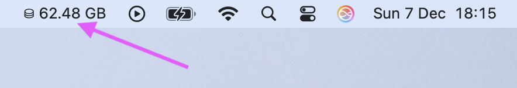

# Free-disk-space-widget

Simple MacOS app to show free disk space in menubar.




## Build

```bash
go build -ldflags="-s -w" .
```

## Run

```bash
./free-disk-space-widget
./free-disk-space-widget -color -warn=20 -err=10
```

Hover over the widget to see what percentage of the startup disk is free.
With `-color`, the icon turns yellow at or below `-warn` (default 20%) and red at or below `-err` (default 10%).
Thresholds accept decimals and must satisfy `0 <= err < warn <= 100`.

## Run on login

Build the widget, then create its LaunchAgent. Pass any widget flags to the script.

```bash
./create-autosta-file.sh -color -warn=20 -err=10
launchctl bootstrap "gui/$(id -u)" "$HOME/Library/LaunchAgents/free-disk-space-widget.autostart.plist"
```

To change the options, stop the agent, run the script again with the new flags, and bootstrap it again.
To uninstall, stop the agent and remove its plist.

```bash
launchctl bootout "gui/$(id -u)/free-disk-space-widget.autostart"
rm "$HOME/Library/LaunchAgents/free-disk-space-widget.autostart.plist"
```
